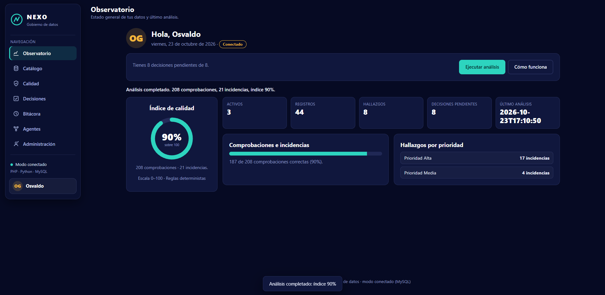
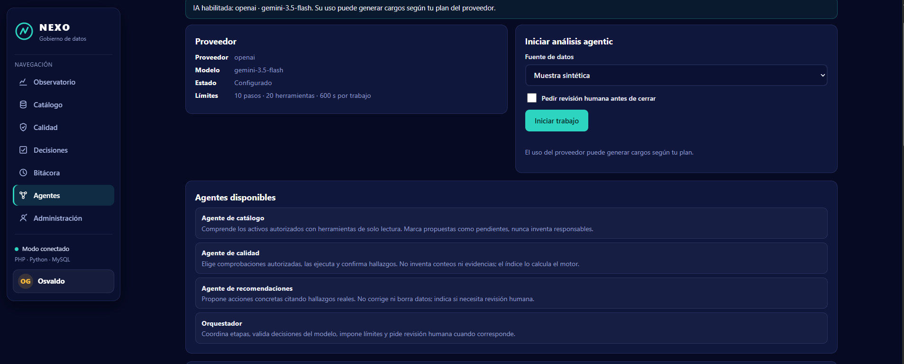
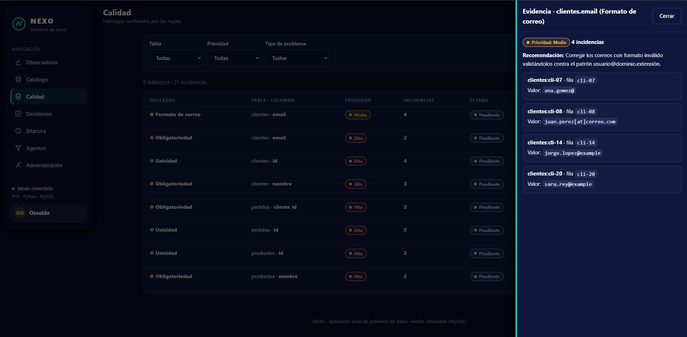
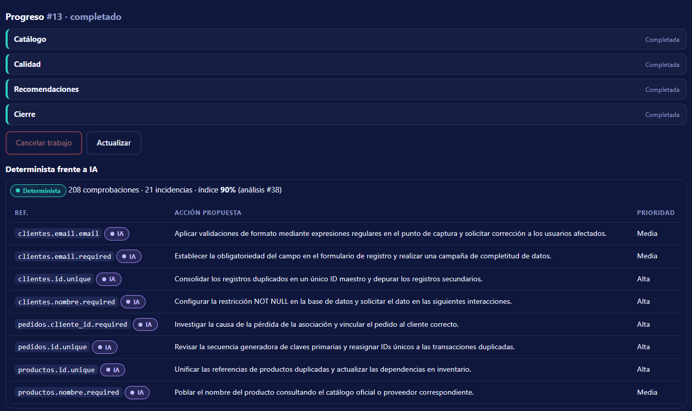

# NEXO · Arquitectura Agentic para Data Governance (MVP)

[](https://github.com/osvaldo070477-source/G19X-UTSLRC-OGV-759-ACADEMIC/actions/workflows/ci.yml)

Recorrido de gobierno de datos con **reglas deterministas verificables** y
**agentes reales**: el modelo decide qué herramientas autorizadas usar;
catálogo → análisis → evidencias → recomendaciones → decisiones → bitácora.

**Autor:** osvaldo070477-source (`Osvaldo070477@gmail.com`) ·
**Repositorio:** `osvaldo070477-source/G19X-UTSLRC-OGV-759-ACADEMIC` ·
Proyecto académico (UTSLRC) · Licencia [MIT](LICENSE) · [Historial de cambios](CHANGELOG.md).

## 1. Demostración inmediata (sin instalar nada)

Abre con doble clic **`public/index.html`** en tu navegador.

- Verás **«Modo demostración — datos de ejemplo»**.
- Pulsa **Ejecutar análisis**: obtendrás 208 comprobaciones, 21 incidencias, 8 hallazgos e índice **90%** (calculados, no escritos a mano).
- Todo funciona sin Internet, sin PHP, sin Python y sin MySQL.
- Lo que decidas se guarda en el navegador (`localStorage`); si no está disponible, se avisa que durará solo la sesión.
- *Live Server de VS Code no ejecuta PHP: sirve la misma demostración.*



*Vista en modo conectado (MySQL). En modo demostración las cifras son las mismas.*

## 2. Modo PHP + Python sin MySQL (memoria)

Necesitas **Python 3.10+** y **PHP 8.1+** (este equipo ya los tiene). Sin dependencias extra.

```powershell
# 1) Crear entorno y .env (solo la primera vez)
python -m venv .venv
python scripts/gen_env.py

# 2) Iniciar el servicio Python (muestra sintética, memoria: se pierde al reiniciar)
.\.venv\Scripts\python.exe backend\app.py --demo --port 8001

# 3) En otra terminal, iniciar PHP (sirve solo public/)
php -S 127.0.0.1:8000 server/router.php

# 4) Abrir en el navegador
# http://127.0.0.1:8000
```

Verás **«Modo local — PHP · Python (memoria)»**. También puedes iniciar ambos servicios con
las tareas de VS Code: **NEXO: servicio Python** y **NEXO: servidor PHP**.
Documentación del flag: `--demo` usa la muestra sintética y guarda en memoria;
sin `--demo` intenta MySQL según `.env` y **falla con error visible** si no hay conexión
(nunca usa simulados en silencio). `backend/app.py --help` muestra `--host` y `--port`.

## 3. Modo completo con MySQL (cuando lo instales)

1. Instala **MySQL 8.0+** (programa ya compilado; instalarlo no es programar en C++).
2. Instala la única dependencia: `.\.venv\Scripts\python.exe -m pip install -r backend\requirements.txt`
3. Crea las bases desde el cliente `mysql` como administrador (en PowerShell **no** funciona `< archivo.sql`;
   usa `source` dentro del cliente), **en este orden**:
   ```sql
   source sql/01_schema_source.sql
   source sql/02_schema_app.sql
   source sql/03_seed_source.sql
   -- sql/04_users_template.sql es plantilla: edita las contraseñas antes de ejecutarla
   source sql/05_agentic.sql
   source sql/06_auth.sql
   source sql/08_usuarios_rol.sql
   source sql/09_carga.sql
   source sql/10_admin_audit.sql
   source sql/07_permisos.sql
   ```
   `07_permisos.sql` va al final: concede permisos a `nexo_app` sobre tablas que
   crean `09` y `10` (`source_audit`, `asset_meta`, `admin_audit`), y MySQL
   rechaza un `GRANT` sobre tablas inexistentes (error 1146). Aplicarlo es
   obligatorio: sin él, el acceso falla con error 1142 porque la cuenta de
   aplicación no puede actualizar intentos de acceso ni sesiones. Si `08`
   marca error 1060 (columna duplicada), ignóralo.
4. Copia `.env.example` o genera `.env` con `python scripts/gen_env.py` y anota las contraseñas reales.
5. Inicia Python **sin** `--demo` y PHP como en el punto 2. Verás **«Modo conectado — PHP · Python · MySQL»**.

## 4. Estructura

| Ruta | Qué es |
|------|--------|
| `public/` | `index.html`, `styles.css`, `js/` (módulos por pantalla: `base`, `catalogo`, `calidad`, `agentes`, `perfil`, `admin`, …), `api.php` (puerta a Python), `index.php` |
| `server/router.php` | Enrutador del servidor PHP (solo sirve `public/`) |
| `backend/` | `app.py` (servicio), `rules.py` (reglas), `sample.py` (muestra), `providers.py` (IA), `agent_tools.py` (9 herramientas), `agents.py` (orquestador), `jobs.py` (trabajos), `requirements.txt` (solo MySQL) |
| `sql/` | Esquemas y migraciones idempotentes en orden: `01`–`03` (base), `05_agentic.sql`, `06_auth.sql`, `08_usuarios_rol.sql`, `09_carga.sql`, `10_admin_audit.sql` y `07_permisos.sql` al final (permisos sobre tablas ya creadas; sin borrar datos) |
| `scripts/` | `gen_env.py` (secretos, conserva lo existente), `check.py` (verificación) |
| `tests/` | `test_rules.py`, `test_agents.py`, `test_auth.py`, `test_carga.py`, `test_equivalencia.py` (sin red ni MySQL; proveedor de prueba) |
| `docs/` | `PRD.md`, `MVP.md`, `arquitectura.md`, `agentes.md`, `backlog.md`, `capturas.md` |

## 5. Agentes y proveedor de IA

El Centro de agentes (pestaña **Agentes**) ejecuta trabajos en segundo plano:
el modelo elige herramientas autorizadas; el índice lo calcula el motor;
puedes cancelar, pedir revisión y reintentar. Las propuestas del modelo
llevan 🤖 IA; las cifras verificadas llevan ✓.

- **Sin configurar:** funciona con el **proveedor de prueba** (respuestas
  programadas, etiquetadas; no es IA real).
- **IA real (OpenAI compatible):** verificado contra la referencia oficial
  `POST {base}/chat/completions` con `tools` y `response_format`
  (https://platform.openai.com/docs/api-reference/chat/create).
  1. Crea tu clave en el panel del proveedor (no la pegues en ningún chat).
  2. Escríbela solo en tu `.env` local: `NEXO_AI_PROVIDER=openai` y `NEXO_AI_API_KEY=tu_clave`.
  3. Opcional: `NEXO_AI_MODEL=gpt-4o-mini` (u otro modelo documentado de tu cuenta).
  4. Reinicia el servicio Python y abre el Centro de agentes: debe decir «IA habilitada».
- **Costos:** la API del proveedor normalmente es de pago por uso y puede
  generar cargos; revisa su página de precios antes de activar. El proveedor
  de prueba y la demo no cuestan nada. Las corridas reales de este proyecto
  usaron la **cuota gratuita** del proveedor (ver §10): sin costo.
- **Cuota gratuita (verificado oct-2026):** Gemini gratis permite ~20
  peticiones/día por modelo (un trabajo agentic usa ~7-10); si se agota,
  el trabajo registra `proveedor_server` con el tiempo de espera y puedes
  reintentarlo al día siguiente. Modelos probados: `gemini-3.5-flash`
  (rápido, ~2 s/turno; la API puede resolverlo a la familia 3.6) y
  `gemini-3.8-flash` (lento, ~1 min/turno). `gemini-2.5-flash` y
  `gemini-2.5-flash-lite` están retirados (404): no los uses.
  `NEXO_AI_TIMEOUT_S` está en 180 por los turnos lentos.
- **Alternativa local:** apunta `NEXO_AI_BASE_URL` a un servidor compatible
  en tu máquina (p. ej. un modelo local con API tipo OpenAI) y usa su modelo.

Límites conservadores (variables `NEXO_AI_*` en `.env`):

| Variable | Defecto | Qué limita |
|----------|---------|------------|
| `NEXO_AI_MAX_STEPS` | 10 | Pasos del modelo por etapa |
| `NEXO_AI_MAX_TOOL_CALLS` | 20 | Llamadas a herramientas por trabajo |
| `NEXO_AI_MAX_RETRIES` | 2 | Reintentos ante respuestas inválidas |
| `NEXO_AI_TIMEOUT_S` | 180 | Espera máxima por llamada al modelo |
| `NEXO_AI_JOB_TIMEOUT_S` | 600 | Duración máxima del trabajo |
| `NEXO_AI_MAX_ROWS_TOOL` | 200 | Filas máximas que ve una herramienta |
| `NEXO_AI_REDACT` | 1 | Enmascara correos antes de enviarlos |



## 6. Detener y volver a iniciar

```powershell
Get-Process python,php -ErrorAction SilentlyContinue | Stop-Process
.\.venv\Scripts\python.exe backend\app.py --demo --port 8001  # terminal 1
php -S 127.0.0.1:8000 server/router.php                       # terminal 2
```
En modo memoria los trabajos se pierden al detener Python; en MySQL los
interrumpidos se marcan y ofrecen **reintento explícito** (trabajo nuevo,
sin duplicar eventos del original).

## 7. Usuarios y sesiones (local)

La **portada de bienvenida** es lo primero que se ve al entrar. El botón de
usuario abre un menú pequeño (**Mi perfil**, **Cerrar sesión**); ya no hay
acceso de invitado en la aplicación real (solo en la demo sin servidor).

La página **Mi perfil** tiene cabecera con iniciales, nombre, correo, rol y
estado, y tres pestañas: **Información** (ficha + cambio de nombre guardado
en MySQL), **Seguridad** (cambio de contraseña verificando la actual) y
**Mi actividad** (tus decisiones con fecha y enlace a Bitácora, paginadas).

- Registro: nombre (2–60 letras), correo válido y único, contraseña de
  8–72 caracteres con mayúscula, minúscula y número (verificada en el
  navegador y de nuevo en el servidor). Rol inicial `operador`, no editable.
- Inicio de sesión: mensajes genéricos, bloqueo de ~15 min tras 5 fallos.
- Contraseñas con PBKDF2 + sal (nunca en texto claro); sesiones opacas de
  8 h guardadas en el servidor (PHP `$_SESSION`); el navegador solo recibe
  tu nombre y correo. Tus decisiones aceptadas quedan firmadas con tu nombre.
- Toda escritura exige además el token CSRF de la sesión (`auth_csrf`).
- **Administración** (rol `admin`): pestaña con lista de cuentas (sin hashes),
  activar/desactivar (sin auto-bloquearse), desbloquear, restablecer claves y
  cambiar roles (`operador`, `lector`, `admin`). El rol **lector** solo puede
  consultar: el servidor rechaza sus escrituras (403).
  Cada acción admin queda registrada (quién, qué, cuándo) y visible en la
  propia pestaña.
  El primer admin se asigna en la PC con
  `.\.venv\Scripts\python.exe scripts/crea_admin.py correo` (cuenta ya registrada).
- Sin MySQL todo es temporal (memoria); con MySQL aplica `sql/06_auth.sql`,
  `sql/07_permisos.sql` (obligatorio para que el acceso funcione),
  `sql/08_usuarios_rol.sql`, `sql/09_carga.sql` y `sql/10_admin_audit.sql`.
- Al registrarte recibes un **código de recuperación** de 12 caracteres
  (guárdalo: solo se muestra una vez). Si olvidas tu clave, úsalo en
  **Iniciar sesión → ¿Olvidaste tu contraseña?**; puedes generar uno nuevo
  desde Mi perfil → Seguridad. Como respaldo, un admin
  puede restablecerla.
- Alcance local de un equipo pequeño: no es autenticación empresarial.

## 7b. Carga de datos (requiere modo conectado y sesión)

- **Catálogo → Agregar registro**: formulario por activo con las columnas
  permitidas; valida igual que el motor y rechaza duplicados y formatos malos.
- **Catálogo → Importar CSV**: sube un `.csv` con encabezados (se acepta BOM
  UTF-8); primero se **valida** (válidas vs. rechazadas con motivo por línea) y
  tú confirmas la importación de las válidas. Se rechazan fechas imposibles,
  números no finitos y valores que exceden las longitudes permitidas. Máximo
  500 filas por lote y 10 000 por tabla.
- Cada fila guarda quién la cargó (`source_audit`); la escritura usa la cuenta
  exclusiva `nexo_wr` (solo INSERT en la fuente).
- **Editar ficha** (admin): cambia descripción y responsable del activo.
- Tras cargar, ejecuta un análisis para ver los datos en Calidad.

## 8. Reglas y muestra
- **Obligatoriedad:** nulo/ausente/espacios = incidencia; **0 no es vacío**.
- **Unicidad:** marca todas las filas del grupo duplicado; claves vacías excluidas.
- **Correo:** `usuario@dominio.extensión`; vacíos excluidos.
- Índice = `redondear((comprobaciones − incidencias) / comprobaciones × 100)`; sin comprobaciones = «Sin evaluar».
- `row_id` (técnica, única) ≠ `id` (negocio, con duplicado intencional `CLI-004`).
- Verificación: `python tests/test_rules.py`, `python tests/test_agents.py`, `python tests/test_auth.py`, `python tests/test_carga.py`, `python tests/test_equivalencia.py`, `python scripts/check.py` y `python scripts/check_ui.py`.
  La prueba de equivalencia compara Python con JavaScript y requiere Node; en CI se ejecuta siempre.



## 9. Seguridad local

Secretos en `.env` (fuera de `public`, en `.gitignore`); el navegador jamás recibe el token
ni la clave del proveedor; en modo servidor la API exige sesión (401 sin ella) y
PHP valida el origen exacto en escrituras; MySQL con cuentas separadas, consultas
parametrizadas y transacciones; decisiones como eventos acumulativos; límite de
10 000 filas por tabla; agentes sin comandos del sistema ni SQL arbitrario.
Las sesiones se revocan al desactivar la cuenta o cambiar la contraseña; los
errores no exponen detalles internos y las respuestas llevan cabeceras
`Content-Security-Policy`, `X-Frame-Options`, `X-Content-Type-Options` y
`Cache-Control: no-store`.
App local para un equipo pequeño con roles (`operador`, `lector`, `admin`) y
auditoría de las acciones de administración; sin SSO ni autenticación empresarial.

## 10. Estado de verificación

Suites (2026-10-24, v1.0.1): `tests/test_rules.py` (**OK**),
`tests/test_agents.py` (**21/21**, con proveedor de prueba),
`tests/test_auth.py` (**24/24**), `tests/test_carga.py` (**9/9**),
`tests/test_equivalencia.py` (**Python ↔ JavaScript**, requiere Node; corre en CI),
`scripts/check.py` (**OK**) y `scripts/check_ui.py` (**OK**). El mismo juego
corre en CI (`.github/workflows/ci.yml`) en cada push, con un trabajo de humo
que levanta MySQL + PHP + Python y ejecuta un análisis de punta a punta.

Flujo agentic vivo PHP→Python con proveedor de prueba (stub): inicio, revisión,
aprobación, cancelación, reintento y rechazos 409; trabajo completado con
208/21/90 y 8 recomendaciones.

**Corrida real con IA (2026-10-16):** desde el Centro de agentes, trabajo **#13**
sobre la fuente MySQL (`origen`), proveedor `openai` (endpoint Gemini
OpenAI-compatible), modelo `gemini-3.5-flash`, `es_prueba = 0`.

| Dato | Valor |
|------|-------|
| Estado | **completado** en ~82 s · 9 llamadas al modelo · 9 herramientas |
| Consumo | 5 264 tokens de entrada + 1 275 de salida = **10 577** |
| Motor determinista (fuente de verdad) | 208 comprobaciones · 21 incidencias · índice **90%** |
| Revisiones humanas | 2 (calidad y recomendaciones), **aprobadas** |
| Recomendaciones | **8 válidas** (5 Alta, 3 Media) persistidas en `nexo_app.recommendations` (job_id = 13) |



El modelo eligió solo herramientas autorizadas y **no inventó conteos ni
evidencias**; las recomendaciones citaron hallazgos reales y el motor siguió
siendo la fuente de toda puntuación.

Flujo de usuarios vivo: registro, duplicado (400), login erróneo (401), bloqueo
tras 5 fallos (423), sesión que sobrevive, decisión firmada con el nombre y
logout (401 posterior). Perfil verificado (registro→perfil→
cambio de nombre→cambio de clave→login con la nueva→decisión→actividad propia→
logout), con fallo de BD sin éxito falso. Recuperación de contraseña verificada
en vivo: registro → generar código nuevo → recover → login con la clave cambiada.

MySQL 8.0 local verificado: cuentas con permisos mínimos, semilla 20/14/10,
análisis real 208/21/90 y decisión que sobrevive al reinicio del servicio.
Ojo: el servicio Python debe iniciarse con `.\.venv\Scripts\python.exe`
(donde está `mysql-connector-python`).
Nota: un 403 aislado tras login bajo ráfagas de PowerShell no se reprodujo en
uso normal; el CSRF rechaza correctamente peticiones sin sesión.

## 11. Uso de asistentes de IA

El proyecto se desarrolló con el apoyo de un **asistente de IA para programar**
(agente de código en el editor). Se declara para dejar constancia, como
recomienda la rúbrica del proyecto; no se penaliza y conviene ser transparente.

- El asistente ayudó a **escribir, revisar y documentar** código, y a ejecutar
  pruebas; **los requisitos, las decisiones de arquitectura y la validación
  final son del autor**.
- Nunca se compartieron credenciales ni datos reales con el asistente: las
  claves viven solo en el `.env` local (fuera del repositorio, ver §9).
- Es distinto del proveedor de IA que la **aplicación** usa en tiempo de
  ejecución (Centro de agentes, §5), que está sujeto a reglas estrictas y a
  revisión humana antes de cualquier escritura.
